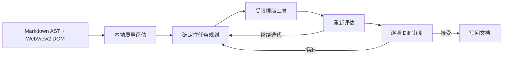

# MarkLeaf AI

面向 A4 打印与纸质阅读的 Markdown 文档工作流 Agent。

`C# / .NET 10` · `WinForms` · `WebView2` · `Markdown AST` · `Offline-first`

MarkLeaf AI 是面向大学课程报告、技术笔记与简历的桌面 Markdown 编辑器。它不会替用户生成正文，而是理解排版意图，调用本地文档工具完成检查、规划、修改、复评和差异审阅。

项目基于开源编辑器 [MarkLeaf](https://github.com/zhuanshunjishi2017/markleaf) 的 Windows 版本进行参赛方向的二次开发。上游仓库归原作者所有；本仓库独立维护，新增能力目前集中在 Windows 版。

## 为什么做这个项目

普通 Markdown 编辑器主要解决“写”和“看”，但课程报告最终经常要打印成 A4：标题跳级、图片溢出版心、表格过宽、孤行寡行和连续空行，往往要到导出 PDF 后才被发现。

MarkLeaf AI 把这些问题变成一个可解释、可复核的本地工作流：



AI 只负责理解复杂自然语言，不负责直接改写文档。评分、任务调度、文档修改、终止条件和 Diff 全部由本地 C# 代码控制。

## 核心功能

### P0：排版智能闭环

- Markdown AST 与 WebView2 渲染后 DOM 联合评估；
- 0–100 分本地质量评分；
- 识别标题跳级、连续空行、图片/表格溢出、孤行寡行、过长行和碎片化短段落；
- 本地状态规划器按严重程度生成任务序列；
- 标题、空行、图片、表格、分页和目录工具；
- 最多 1–5 轮“评估 → 规划 → 执行 → 复评”；
- 每项改动独立勾选、接受或拒绝；
- 支持撤销整次 Agent 应用，避免覆盖之后的人工编辑。

### P1：导入、导出与打印

- 导入 TXT；
- 导入受限 HTML（`p / h1-h6 / img / table`）；
- 导出 Markdown、HTML、PDF 和长图；
- 复用 WebView2 打印管线和 A4 样式。

### P2：排版模板库

- 内置“学术报告、技术笔记、简历”三套模板；
- 可视化编辑字体、字号、行距、段后距、行长、图片宽度和表格宽度；
- 右侧 A4 标准样张实时预览；
- 用户可新建、复制、导入和导出模板；
- 支持从自然语言描述或 Markdown 样例生成模板草稿；
- JSON 作为高级格式，普通用户无需手写。

### 文档工作流 Agent

AI 模式与专注模式并列，是主窗口中的文档工作区，而不是连续弹窗。用户可以直接表达：

```text
检查这篇报告的排版
在不改正文的前提下优化为 A4
只生成目录
让图片适合 A4 版心
做一套课程报告模板
导出为 HTML
```

Agent 会先展示理解与计划，再调用白名单内的本地工具。写作、续写、翻译、润色正文以及任意系统操作均不在能力范围内。

## 离线与隐私边界

- 未启用 AI 时不会加载可选 AI 客户端；
- 评估、规划、优化、模板、导入、导出和打印均可离线使用；
- OpenAI、DeepSeek、Kimi、通义千问、智谱 GLM 等兼容服务按需连接；
- API Key 通过 Windows 凭据管理器保存，不写入普通设置文件；
- 自然语言请求只发送当前对话中的要求和必要工具摘要，不上传完整文档正文；
- 任何正文改动都必须经过用户的差异审阅。

## 技术架构

```text
视图层
├── WinForms 主窗口与 AI 模式
├── 排版检查与 Diff 审阅
└── 模板库与标准样张

文档处理层
├── Markdown AST
├── WebView2 DOM 测量
└── TXT / 受限 HTML 导入

智能引擎层
├── TypographyEvaluator
├── TypographyPlanner
├── TypographyExecutor
└── TypographyFeedbackEngine

AI 交互层（按需加载）
├── 本地白名单意图路由
└── OpenAI-compatible 自然语言解析

工具能力层
├── 标题 / 空行 / 图片 / 表格 / 分页 / 目录
└── DocumentChange / Diff / 撤销
```

设计与实现细节见 [A4 排版智能体说明](./docs/markleaf-typography-agent.md)。

## 快速开始

### 环境

- Windows 10/11；
- .NET 10 SDK；
- WebView2 Runtime；
- Node.js 22.12+ 与 Corepack（仅重新构建编辑器前端时需要）。

### 构建并运行 Windows 版

```powershell
corepack pnpm install:editor-web
corepack pnpm build:editor-web
dotnet restore .\apps\windows\MarkLeaf\MarkLeaf.csproj
dotnet build .\apps\windows\MarkLeaf\MarkLeaf.csproj --configuration Release --no-restore
dotnet run --project .\apps\windows\MarkLeaf\MarkLeaf.csproj
```

打开应用后，通过“查看 → AI 模式”或 `F10` 进入文档工作流 Agent。

## 测试与演示

```powershell
dotnet test .\MarkLeaf.slnx --configuration Release
```

当前 Windows 测试覆盖评估器、规划器、执行器、反馈循环、模板 JSON、自然语言意图、Agent 交互、Diff 审阅、撤销和响应式布局。本次参赛功能提交已通过全部 220 项测试。

比赛现场可使用 [排版演示文档](./docs/typography-demo.md)，依次展示 AI 模式、本地计划、逐项 Diff、拒绝重规划、撤销、模板标准样张和 PDF/HTML 导出。

## 参赛版代码位置

```text
apps/windows/
├── MarkLeaf/
│   ├── Services/Typography/          # AST、评估、规划、执行、反馈、模板
│   ├── Services/AI/                  # 意图路由、服务商配置、凭据存储
│   ├── Services/ImportExport/        # TXT / HTML 导入
│   └── UI/                           # AI 工作区、排版工作台、模板库
├── MarkLeaf.AI.Contracts/            # 可选 AI 边界接口
├── MarkLeaf.AI.OpenAICompatible/      # 按需加载的 AI 客户端
└── tests/MarkLeaf.Tests/              # Windows 自动化测试
```

上游保留的 macOS 与 VS Code 代码仍在仓库中，但本参赛项目新增的排版 Agent、AI 模式和模板工作流当前以 Windows 版本为实现与答辩对象。

## 上游与许可证

本项目基于 [zhuanshunjishi2017/markleaf](https://github.com/zhuanshunjishi2017/markleaf) 二次开发，感谢原项目作者及贡献者提供的 Markdown 编辑器基础。上游仓库未被本项目修改或推送。

项目继续遵循 [MIT License](./LICENSE)，第三方依赖说明见 [THIRD-PARTY-NOTICES.md](./THIRD-PARTY-NOTICES.md)。

<details>
<summary>展开查看上游 MarkLeaf 基础功能与多平台构建说明</summary>

## 上游 MarkLeaf 基础能力（保留说明）

[English](./docs/README.en.md) | [日本語](./docs/README.ja.md) | [繁體中文](./docs/README.zh-TW.md)

MarkLeaf 是轻量化 Markdown 可视化编辑器，提供 Windows/macOS 原生应用和 VS Code 扩展，追求简洁的界面与排版，为思考、阅读与写作提供专注的空间。

项目最初由 [fcz](https://github.com/zhuanshunjishi2017) 发起并制作，初版仅支持 Windows 平台，后由 [Na Bian](https://github.com/Na-Bian) 提供了 macOS 版本的支持。**当前，Windows 版本与 macOS 版本共同更新。**

## 应用截图


## 功能介绍

### 丰富的排版样式与配色方案

#### **排版样式**

应用内置丰富的排版样式，例如：

- **网页**：适合屏幕阅读和日常编辑，是大多数编辑器较为主流的 Markdown 渲染风格，追求效率和清晰的体验。**(上图中左上窗口所用排版)**
- **印刷品**：采用印刷品常用的衬线字体与黑体排版，段落两端对齐，首行缩进，标题居中，页面留白宽裕，模拟现代书籍排版效果。适合长文写作与阅读。
- **LaTeX**：采用 CMU 字体和类似于 LaTeX 的 document 文档的排版，引用与提示框采用 tcolorbox 风格，尽可能贴近 LaTeX渲染的风格。**（上图中中部窗口所用排版）**
- **铅字印刷**：采用特里王老师制作的汇文、朝华系列字体以及京华老宋体，在印刷品布局基础上营造更为复古的样式。**（上图中右上窗口所用排版）**

> [!NOTE]
> 部分主题可能需要用到特定的字体以获得更佳体验，您可以前往以下页面，或直接从 [Release](https://github.com/zhuanshunjishi2017/markleaf/releases) 中下载相关字体包并将其安装到计算机上。
> 
> - [Computer Modern 系列字体](https://www.fontsquirrel.com/fonts/computer-modern)（LaTeX 默认排版字体）
> - [汇文、朝华系列字体以及京华老宋体](https://huozi.cool/) （铅字印刷排版，由特里王制作的免费字体）
> - [霞鹜文楷](https://github.com/lxgw/LxgwWenKai) （由 Lxgw 制作的优秀开源开源中文字体）

#### 配色方案

应用支持**多种颜色主题**，包含深色与浅色，<strong>实现了 Win32 菜单对深色模式的支持。</strong>以下是部分预置的颜色主题效果。

> [!TIP]
> 由于配色方案与渲染主题**都是 CSS 样式**，故您可以**完全自定义**颜色主题和排版样式，之后，我们也会推出相关的主题编辑器可供编辑。

### Markdown 语法支持

基于 **Tiptap/ProseMirror** 编辑器内核，支持完整的 CommonMark 和 GitHub Flavored Markdown 语法。

**另外还支持：**

- LaTeX 数学公式（由 KaTeX 渲染）
- Mermaid 图表（将图表渲染为 SVG）
- 脚注的定义引用与跳转
- GitHub 风格警示框，包含备注、提示、警告等，在每种主题下有不同的显示效果。
- <strong>（自定义语法）</strong>图片、表格显示标题。

### 优秀的导出效果

Windows 原生版支持 PDF、HTML、PNG/JPG 长图和打印；macOS 原生版支持 PDF、HTML、PNG/JPG 长图和系统打印。VS Code 扩展现已接入 PDF、独立 HTML、PNG/JPG 长图、预览和浏览器打印，默认采用 MarkLeaf 极简排版。PDF 可设置纸张、方向、页边距、页眉页脚和页码；长图可按高度连续分片。除 HTML 文件导出外，扩展使用 `puppeteer-core` 调用已安装的 Chrome/Edge，不捆绑或下载浏览器。

### 极简但完善的操作逻辑与功能

下面的工作区、多窗口和内置源码模式介绍以原生应用为主。VS Code 扩展使用 VS Code 的资源管理器、窗口、标签页和源码编辑器，其功能入口见下方扩展说明。

- **工作区管理**：支持打开文件夹作为工作区，按树视图或列表视图查看文件，按名称/内容搜索文档。文件变化自动刷新时保留目录展开、选中项和滚动位置。当前仅列出 `.md`、`.txt` 文本及文件夹，不读取 PDF、图片或压缩包内容。
- **多窗口与多标签页**：支持打开多个窗口实例，也可将文档在新窗口中打开。另外，应用支持在同一个窗口中打开多个标签页，每个标签页独自管理其文档内容。
- **源码模式**：内置 CodeMirror 6 源码编辑模式，可在可视化编辑和 Markdown 源码之间即时切换。
- **不合规 Markdown 标记自动转换**：针对中文 Markdown 文本常见的**暴露字面星号**的问题，应用能够检测不符合 CommonMark 规范的星号标记并转化为 HTML 标签。
- **菜单与快捷键**：所有的段落与格式操作均可通过上下文菜单与段落格式按钮完成。应用还具有完备的快捷键自定义系统。
- **LaTeX 公式输入辅助**：无需记忆 LaTeX 源码，涵盖大部分数学符号，通过点击即可输入复杂的 LaTeX 公式。
- **专注阅读与写作**：提供专注模式、打字机模式、极简模式，也可进入全屏幕编辑。
- **中西文排版友好**：可在首选项中选择首选的汉字字形规范（简体中文/繁体中文/日文/韩文），同时，**应用会在中文与西文之间自动添加间距，无需手动插入空格。**

## 平台支持


| 平台         | 所用技术                                            | 代码目录                    |
| ---------- | ----------------------------------------------- | ----------------------- |
| Windows    | C# + .NET 10 WinForms + WebView2                | `apps/windows/MarkLeaf` |
| macOS      | Swift + AppKit + WKWebView                      | `apps/macos`            |
| VS Code 扩展 | TypeScript + CustomTextEditorProvider + Webview | `apps/vscode`           |


三个宿主共享编辑内核与排版样式。VS Code 扩展使用已有 VS Code 运行环境，不引入独立 Electron 依赖或桌面壳。支持阅读与可视化编辑、格式刷、表格、脚注、公式与 Mermaid、图片粘贴和拖放、查找替换、大纲及排版偏好。保存、撤销重做、标签页和原生源码由 VS Code 管理，支持源码切换及并排。

VS Code 扩展 0.2.8 提供 36 项设置和 67 项可配置格式操作；公式与图表使用内核统一的选中、再次点击展开和视口内浮层定位行为。快捷键配置仅作用于 VS Code 中的 MarkLeaf，不改变原生应用的键位。项目与扩展说明均提供简体中文、英文、日文和繁体中文；扩展界面尚未全部本地化，具体入口与范围见 [扩展说明](./apps/vscode/README.md) 和 [功能对应说明](./apps/vscode/docs/feature-parity.md)。

三个产品的文档交互由共享内核定义：“复制 HTML”得到源码文本；可视编辑中的普通文本粘贴和“粘贴纯文本”均解析 Markdown，源码编辑保留字面文本。粘贴提示区分成功、格式转换、纯文本降级及失败，并保留降级原因。

正文渲染同样默认使用 `minimal`（网页·极简），保留字体层级、留白和表格细节；已保存的用户或工作区排版选择优先。

VS Code 1.120+ 中的 Markdown Git 对比默认使用原生源码 diff，显示增删高亮；普通文件仍默认使用 MarkLeaf。

## 项目结构

```text
markleaf/
├── apps/
│   ├── windows/                  # Windows 原生应用（C# WinForms）
│   │   ├── MarkLeaf/             #   主程序（.NET 10 + WebView2）
│   │   └── setup/                #   Inno Setup 安装器
│   ├── vscode/                   # VS Code Markdown 阅读与编辑扩展（TypeScript）
│   │   ├── src/                  #   扩展进程：文档适配、命令、导出
│   │   └── webview/              #   webview 适配层：扩展协议、设置、快捷键
│   └── macos/                    # macOS 原生应用（Swift AppKit + WKWebView）
│       ├── Sources/MarkLeaf/     #   主程序
│       ├── Changelog/            #   产品更新日志（四语言）
│       └── script/               #   构建 / 发布脚本
├── packages/
│   ├── editor-core/              # 共享文档与渲染内核（TypeScript）
│   ├── editor-web/               # macOS / Windows 的 webview 适配层
│   └── styles/                   # 共享排版 / 主题样式（三个宿主共用）
├── MarkLeaf.slnx                 # Windows 解决方案
├── Directory.Build.props
├── global.json
├── appicon.png / fileicon.png    # 共享应用图标
├── LICENSE / THIRD-PARTY-NOTICES.md
└── README.md
```

## 技术架构

```text
packages/editor-core（共享文档与渲染内核）+ packages/styles（共享排版）
├── packages/editor-web    → apps/windows → WinForms + WebView2 → 原生消息桥
│                          → apps/macos   → AppKit + WKWebView  → 原生消息桥
└── apps/vscode/webview    → apps/vscode  → VS Code Webview    → TextDocument / WorkspaceEdit

内核负责文档规则、渲染、编辑、导出与排版，不含任何宿主通信与宿主 UI；
宿主差异经 host-capabilities 的能力注入表达，内核内不做宿主类型判断。
渲染栈（Tiptap / ProseMirror / CodeMirror / Mermaid / KaTeX）由内核唯一持有，
适配层不重复声明，避免解析出第二份副本。

Windows/macOS：editor-web/src/main.ts，内置 CodeMirror 6 源码模式
VS Code：apps/vscode/webview/src/vscode.ts，使用 VS Code 原生 Markdown 源码编辑器
```

内核现在统一提供命令状态、公式／图表点击与源码框操作、右键选区、大纲与文内链接、格式刷、打字机滚动、排版依赖、图片展示及 HTML 导出。产品菜单消费内核投影的 `enabled` / `checked`，系统对话框、剪贴板、文件 API 和原生外观由适配层接入。空选区的行内格式命令只设置后续输入格式，已有整段文字保持原样。

共享渲染内核通过 `build:editor-web` 或 `build:products` 编译，供 macOS、Windows 和 VS Code Webview 加载；无 DOM 的 `document-kernel.cjs` 仅由 VS Code Node.js 加载。macOS 与 Windows 继续使用各自原生的编码、文件读写和恢复实现。`build:products` 会在构建 VS Code 时额外生成文档内核。

职责与本轮收敛范围见 [内核边界说明](./docs/kernel-boundaries.md)。

## 构建与运行

### VS Code 扩展

从仓库根目录执行，Node.js 22.12+，通过 Corepack 使用项目固定的 pnpm 11.9.0。安装入口按内核、Webview、扩展宿主的顺序准备三个独立包：

```bash
corepack pnpm install:vscode
corepack pnpm package:vscode
```

产物为 `artifacts/markleaf-vscode-0.2.8.vsix`。

扩展版本由 `apps/vscode/package.json` 的 `version` 管理，与原生产品版本独立。当前扩展 ID 为 `zhuanshunjishi2017.markleaf`。使用 MarkLeaf 的“全部设置”或扩展详情中的 **扩展设置 / Extension Settings** 打开设置页；运行时按当前安装包 ID 定位，避免沿用旧本地包的搜索筛选。`markleaf.*` 配置键保持不变。

在 VS Code 中使用 <strong>Install from VSIX…</strong> 安装生成的扩展包。新打开的 `.md`、`.markdown` 文件默认进入 MarkLeaf；已有源码标签使用 <strong>Reopen Editor With… → MarkLeaf</strong>，已有默认关联使用 <strong>Configure default editor for…</strong> 调整。<strong>Ctrl+Shift+V</strong>（macOS 为 <strong>Cmd+Shift+V</strong>）在原生源码与渲染视图间切换。

升级后先保存文档，再运行 <strong>Developer: Reload Window</strong>。若设置项缺失或提示 `markleaf.shortcuts` 未注册，需要重新加载整个窗口。通过 <strong>视图 → 快捷键…</strong> 录入格式键位。阅读不会回写；可视化编辑可能规范化 Markdown 格式，详见 [扩展使用与保真边界](./apps/vscode/README.md)。

### Web 前端编辑器

macOS 与 Windows 共用此产物。`editor-web` 以 `link:` 依赖 `editor-core`，
内核依赖须先安装，符号链接才可用：

```bash
corepack pnpm install:editor-web
corepack pnpm build:editor-web
```

前端产物位于 `packages/editor-web/dist`；目录内的 `kernel/` 是统一构建后复制的渲染内核。

测试单独执行：原生宿主协议使用 `corepack pnpm test:editor-web`，共享内核契约使用 `corepack pnpm test:editor-core`。

### Windows

```powershell
corepack pnpm install:editor-web
corepack pnpm build:editor-web
dotnet restore .\apps\windows\MarkLeaf\MarkLeaf.csproj
dotnet build .\apps\windows\MarkLeaf\MarkLeaf.csproj --no-restore
dotnet run --project .\apps\windows\MarkLeaf\MarkLeaf.csproj
```

<strong>Windows 发布支持两种安装包格式：Inno Setup 生成用于 GitHub Release 的</strong> `.exe`<strong>，MSIX 生成用于 Microsoft Store 的商店包。MSIX 构建默认输出</strong> `win-x64` <strong>和</strong> `win-arm64` <strong>两个自包含架构，并支持简体中文、繁体中文、英语和日语资源。</strong>

MSIX 的商店身份、签名与构建参数见 [MSIX 打包说明](./apps/windows/msix/README.md)。

### macOS

```bash
# 一次性（构建前端 + 编译 + 打包 .app + 启动）
./apps/macos/script/build_and_run.sh

# 发布打包（.app / ZIP / 品牌 DMG / 校验和）
./apps/macos/script/release/package.sh
```

默认输出到 `apps/macos/dist/release`，包含 arm64 应用 ZIP、DMG、dSYM 和校验和。已完成 `corepack pnpm build:products` 时，可设置 `MARKLEAF_USE_BUILT_EDITOR_WEB=1` 复用本次内核和前端产物后打包。

## 许可证

应用采用 MIT 许可证。见 [LICENSE](./LICENSE)。

</details>
